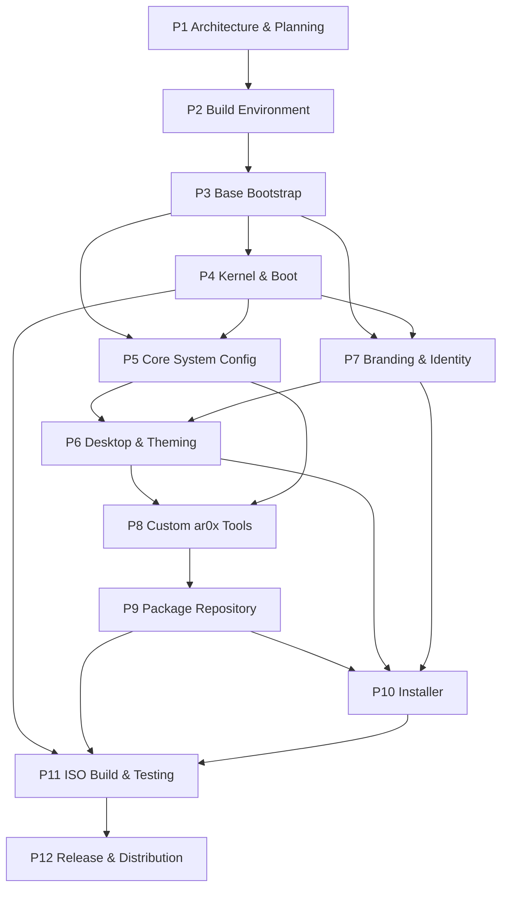

# ar0x — Architecture & Project Plan

> **PHASE 1 DELIVERABLE** — the single source of truth for the ar0x distribution.
> Document version: `1.0.0` · Date: `2026-11-03` · Repository: `ar0x1/ar0xOS`
> Branch: `arena/53f7f9f8-ar0xos` · Status: **Phase 1 complete, awaiting confirmation gate**
>
> All versions in this document were verified against upstream releases on 2026-11-03.
> Verification evidence and URLs: [`docs/architecture/COMPONENT_VERSIONS.md`](docs/architecture/COMPONENT_VERSIONS.md).

---

## 0. How to read this document

- This file is the **contract** for Phases 2–12. Every script, config, and asset produced later
  must land at a path listed in §4 and must use a version listed in §5.
- **No phase starts until you explicitly confirm the previous phase.** Phase 1 ends at §17
  with a confirmation gate.
- Companion documents (all part of Phase 1):

  | File | Purpose |
  |---|---|
  | `/home/user/ar0xOS/PROJECT_PLAN.md` | This file — master architecture + plan |
  | `/home/user/ar0xOS/docs/architecture/BUILD_LAYOUT.md` | Full build-environment directory structure |
  | `/home/user/ar0xOS/docs/architecture/COMPONENT_VERSIONS.md` | Every major component + version + source + pin policy |
  | `/home/user/ar0xOS/docs/architecture/DEPENDENCY_GRAPH.md` | Build-order DAG, topological order, critical path |
  | `/home/user/ar0xOS/docs/architecture/DECISIONS.md` | Architecture Decision Records with tradeoffs |
  | `/home/user/ar0xOS/docs/architecture/RISK_REGISTER.md` | Risks, ⚠️ warnings, mitigations |
  | `/home/user/ar0xOS/config/versions.env` | Machine-readable version pins for all later scripts |
  | `/home/user/ar0xOS/.gitignore` | Keeps ISO/work artifacts out of Git |

- **Sandbox honesty note:** this repository is edited in a non-root sandbox. `mkarchiso`,
  `pacstrap`, `chroot`, `grub-install`, and QEMU boot tests **cannot execute here**. All files are
  real and copy-pasteable for a root-capable Arch Linux host; scripts are syntax-checked with
  `bash -n` and `shellcheck` where available, but functional boot verification is a **manual
  host-side step** (§14).

---

## 1. Product definition

| Property | Value |
|---|---|
| Distribution name | `ar0x` |
| OS `ID` | `ar0x` |
| `ID_LIKE` | `arch` |
| First release | `0.1.0`, codename **"Neon Root"** |
| Architecture | `x86_64` only for v0.1 (aarch64 deferred to v0.2) |
| Target audience | Developers (with a security/privacy-conscious default posture) |
| Aesthetic | Cyberpunk / Dark-Hacker — near-black bases, neon cyan + magenta accents |
| ISO target | ~2 GB ("standard"), hard size gate at 2.2 GB |
| Installer | Calamares 3.4.3 GUI (auto + manual partitioning) |
| Channels | `testing` (rolling), `stable` (quarterly ISO refresh) |
| Artifact name | `ar0x-0.1.0-x86_64.iso` |
| License policy | Base = Arch package licenses; ar0x-authored code = GPL-3.0-or-later; ar0x artwork = CC BY-SA 4.0 |

### 1.1 Goals

1. A **bootable, installable** x86_64 live ISO that boots on both UEFI and BIOS (QEMU + real hardware).
2. A coherent cyberpunk identity: GRUB → Plymouth → SDDM → Hyprland → GTK/Qt → fastfetch,
   all using one palette (§7 of `DECISIONS.md`).
3. A **developer-ready** session out of the box: git, compiler toolchain, container tooling optional,
   zsh + starship, sane defaults, no bloat.
4. A **reproducible build**: frozen Arch archive snapshot, version pins, generated package lockfile.
5. Real distribution engineering: signed custom `[ar0x]` repo, CI-built packages, PKGBUILDs,
   SHA256 + detached GPG signatures, documented release process.

### 1.2 Non-goals for v0.1

- No aarch64, no RISC-V, no 32-bit (`i686`), no musl variant.
- No SELinux (AppArmor chosen; see ADR-009).
- No immutable/read-only root, no A/B updates, no `ostree`.
- No custom kernel patches or out-of-tree kernel modules in v0.1 (⚠️ see RISK-001).
  Phase 4 enforces this: `build-kernel.sh --check` and `validate-versions.sh` both
  fail if any `*.patch` / `*.diff` appears in `config/kernel/patches/`.
- No Secure Boot **enforcement by default** — shim + signed binaries are provided, but MOK
  enrollment remains an explicit manual user choice (§14).
- No official mirror network at v0.1; GitHub Releases is the primary distribution channel.

---

## 2. Architecture at a glance

### 2.1 Layer stack

```
┌──────────────────────────────────────────────────────────────────────────┐
│ L7  Applications  │ code editor, terminal, browser, ar0x-welcome/info    │
├──────────────────────────────────────────────────────────────────────────┤
│ L6  Session       │ Hyprland 0.57.1 (Lua config) + Waybar + hyprpaper     │
│                   │ hyprlock / hypridle / xdg-desktop-portal-hyprland     │
├──────────────────────────────────────────────────────────────────────────┤
│ L5  Display mgr   │ SDDM 0.21.0 (X11 greeter → Wayland session)          │
├──────────────────────────────────────────────────────────────────────────┤
│ L4  System svcs   │ systemd 262.1 · NetworkManager · PipeWire 1.6.10      │
│                   │ WirePlumber · journald · nftables · AppArmor · polkit │
├──────────────────────────────────────────────────────────────────────────┤
│ L3  Userspace     │ glibc 2.44 · pacman · bash 5.3.20 (scripts)          │
│                   │ zsh (interactive) · Python 3.14.9 · Qt 6.12 · GTK4   │
├──────────────────────────────────────────────────────────────────────────┤
│ L2  Kernel        │ linux-lts 6.18.59 · mkinitcpio 42.2 initramfs        │
│                   │ Plymouth 26.134.222 splash (built into initramfs)     │
├──────────────────────────────────────────────────────────────────────────┤
│ L1  Bootloader    │ GRUB 2.16 — UEFI (grubx64.efi) + BIOS (isolinux/      │
│                   │ syslinux) · optional shim + MOK for Secure Boot       │
├──────────────────────────────────────────────────────────────────────────┤
│ L0  Firmware      │ UEFI 2.x (CSM-capable) or legacy BIOS                 │
└──────────────────────────────────────────────────────────────────────────┘
```

### 2.2 Boot chain — UEFI

```
UEFI firmware
  └─> EFI/BOOT/BOOTx86_64.EFI        (shim, optional Secure Boot path)
        └─> EFI/BOOT/grubx64.efi      (GRUB 2.16, signed)
              └─> grub.cfg  →  /ar0x/boot/x86_64/vmlinuz-linux-lts
                             +  /ar0x/boot/x86_64/initramfs-linux-lts.img
                    └─> kernel 6.18.59 → mkinitcpio initramfs
                          └─> Plymouth ar0x splash (early KMS)
                                └─> systemd PID 1 → graphical.target
                                      └─> SDDM → Hyprland (Wayland session)
```

### 2.3 Boot chain — BIOS

```
BIOS → MBR/isohybrid → isolinux/syslinux (archiso BIOS boot entries)
  └─> same vmlinuz-linux-lts + initramfs-linux-lts.img
        └─> identical kernel/init/systemd/SDDM/Hyprland chain as §2.2
```

> **Design invariant:** UEFI and BIOS paths differ **only** in the stage-1 loader. They must
> load byte-identical kernel + initramfs images. This is why GRUB was chosen over
> `systemd-boot`/`rEFInd` (see ADR-004) and why Phase 11 tests both paths.

### 2.4 Live ISO runtime

```
ISO9660 (isohybrid, volume label AR0X_010)
├── /EFI/BOOT/                      UEFI loaders + GRUB config
├── /isolinux/ , /syslinux/         BIOS loaders + menus
├── /ar0x/boot/x86_64/
│   ├── vmlinuz-linux-lts
│   ├── initramfs-linux-lts.img
│   └── airootfs.sfs               zstd-compressed squashfs root
└── /ar0x/boot/memtest86+/         optional memtest

Boot: kernel boots → initramfs mounts airootfs.sfs read-only (loop)
      → overlayfs (tmpfs upper, cow_spacesize=50% of RAM by default)
      → / is writable in RAM; "copytoram" boot option copies the whole sfs to RAM
      → Calamares can unmount/overwrite the source device safely
```

### 2.5 Installed system

```
Disk (GPT for UEFI / MBR for BIOS)
├── EFI System Partition (FAT32, 512 MiB, /boot/efi)   [UEFI only]
├── BIOS Boot Partition (1 MiB, no FS)                  [BIOS+GPT only]
├── / (ext4 default; btrfs offered with @, @home, @log, @pkg subvolumes)
└── swap (optional file or partition)

Calamares copies the live airootfs → target, generates /etc/fstab, installs
GRUB, creates the user, then removes live-only hooks (ar0x-live user,
autologin, live init scripts) and enables the first-boot ar0x-welcome unit.
```

---

## 3. Confirmed preference stack (locked 2026-11-03)

| # | Preference | Decision | Locked consequences |
|---|---|---|---|
| 1 | Base | **Arch** | `archiso` profile, PKGBUILD packaging, rolling repos |
| 2 | C library | **glibc 2.44** | Binary NVIDIA/Steam compatible; no musl patches |
| 3 | Package manager | **pacman** | `repo-add -s` custom repo; `SigLevel` signing |
| 4 | Init system | **systemd 262.1** | NetworkManager, journald, resolved, logind, timedated |
| 5 | Display server | **Wayland** | X11 only via XWayland fallback |
| 6 | Desktop / WM | **Hyprland 0.57.1** | ⚠️ **`hyprland.lua`, not `hyprland.conf`** |
| 7 | Bootloader | **GRUB 2.16** | BIOS + UEFI + theme + Secure Boot shim |
| 8 | Kernel | **linux-lts 6.18.59** | LTS until Dec 2027; no custom patches in v0.1 |
| 9 | Shell | **zsh** (interactive), **bash 5.3.20** (all scripts) | Every `*.sh` keeps `#!/bin/bash` |
| 10 | Audience | **Developers** | Toolchain + git + containers optional in welcome app |
| 11 | Vibe | **Cyberpunk / Dark-Hacker** | Palette: see §7 |
| 12 | ISO size | **~2 GB standard** (gate 2.2 GB) | Size budget in §7 |
| 13 | Installer | **Calamares 3.4.3 GUI** | Codeberg source, not the archived GitHub mirror |

Optional context not explicitly overridden by the user, therefore defaulted here
(change any of these at the Phase 1 gate):
`x86_64 only`, `Secure Boot = supported-but-not-enforced`, `reproducible builds = yes`,
`release cadence = quarterly ISO refresh`, `default locale = en_US.UTF-8`,
`default timezone = UTC`, `default keymap = us`, `default filesystem = ext4`.

---

## 4. Build environment directory structure

Complete specification: [`docs/architecture/BUILD_LAYOUT.md`](docs/architecture/BUILD_LAYOUT.md).
Two roots are deliberately separated:

- **SOURCE ROOT** = `/home/user/ar0xOS` — versioned in Git, small, human-edited.
- **BUILD ROOT** = `/opt/ar0x-build` — root-owned, git-ignored, disposable, 40 GB+ of scratch.

```
/home/user/ar0xOS/                         # SOURCE ROOT (Git)
├── README.md                              # Phase 12 (currently just "# ar0xOS")
├── PROJECT_PLAN.md                        # Phase 1  ← this file
├── .gitignore                             # Phase 1
├── docs/
│   ├── architecture/                      # Phase 1 docs
│   │   ├── BUILD_LAYOUT.md
│   │   ├── COMPONENT_VERSIONS.md
│   │   ├── DEPENDENCY_GRAPH.md
│   │   ├── DECISIONS.md
│   │   └── RISK_REGISTER.md
│   ├── TESTING_CHECKLIST.md               # Phase 11
│   └── RELEASE_NOTES_TEMPLATE.md          # Phase 12
├── config/
│   ├── versions.env                       # Phase 1 — version pins for all scripts
│   ├── pacman.conf.build                  # Phase 3 — FROZEN archive snapshot repos
│   ├── pacman.conf.installed              # Phase 5/9 — rolling + [ar0x] repo
│   ├── packages.x86_64                    # Phase 3 — canonical ISO package list
│   ├── bootstrap_packages.x86_64          # Phase 3 — bootstrap buildmode list
│   ├── kernel/
│   │   ├── README.md                      # Phase 4 — RISK-001 policy
│   │   ├── ar0x-lts.config                # Phase 4 — exact menuconfig selections
│   │   └── patches/README.md              # Phase 4 (EMPTY in v0.1, by design)
│   ├── mkinitcpio.conf                    # Phase 4
│   ├── mkinitcpio.d/linux-lts.preset      # Phase 4
│   ├── default/grub                       # Phase 4
│   ├── plymouth/plymouthd.conf            # Phase 4
│   ├── system/                            # Phase 5 — mirrors /etc/ paths 1:1
│   │   ├── NetworkManager/
│   │   ├── pipewire/
│   │   ├── systemd/
│   │   ├── security/
│   │   └── locale/
│   ├── desktop/                           # Phase 6
│   │   ├── hypr/hyprland.lua              # ⚠️ Lua, not .conf
│   │   ├── waybar/
│   │   ├── gtk-3.0/ , gtk-4.0/
│   │   ├── qt5ct/ , qt6ct/
│   │   ├── fontconfig/
│   │   └── skel/                          # → /etc/skel in airootfs
│   ├── branding/                          # Phase 7
│   │   ├── os-release, lsb-release, issue, motd
│   │   ├── fastfetch/
│   │   └── palette.conf
│   ├── calamares/                         # Phase 10
│   │   ├── settings.conf
│   │   └── modules/
│   └── repo/                              # Phase 9
│       └── pacman.conf.ar0x-entry
├── archiso/                               # Phase 3 — COMPLETE archiso 92 profile
│   ├── profiledef.sh                      # CANONICAL (sourced by mkarchiso)
│   ├── packages.x86_64                    # synced from config/packages.x86_64
│   ├── bootstrap_packages.x86_64          # synced from config/bootstrap_packages.x86_64
│   ├── pacman.conf                        # rendered from config/pacman.conf.build
│   ├── grub/grub.cfg                      # UEFI GRUB menu (Phase 4 brands it)
│   ├── syslinux/syslinux.cfg              # BIOS isolinux menu (Phase 4 brands it)
│   ├── efiboot/                           # unused: uefi.grub, not systemd-boot
│   ├── airootfs/                          # overlay copied into the live root
│   │   ├── etc/mkinitcpio.conf.d/archiso.conf       # MANDATORY live hooks
│   │   ├── etc/pacman.d/hooks/90-ar0x-build-stamp.hook
│   │   ├── etc/{hostname,locale.conf,vconsole.conf}
│   │   └── usr/ , root/ , opt/ , var/    # NO customize_airootfs.sh (deprecated)
│   └── bootstrap.sh                       # Phase 3
├── assets/
│   ├── logo/ar0x-logo.svg                 # Phase 7
│   ├── wallpapers/                        # Phase 6/7 (placeholder paths)
│   ├── plymouth/ar0x/                     # Phase 4/7
│   ├── grub-theme/ar0x/                   # Phase 4/7
│   ├── syslinux/splash.png                 # Phase 4/7
│   ├── sddm/ar0x/                         # Phase 6/7
│   ├── icons/ , cursors/
│   └── ascii/ar0x-ascii.txt               # Phase 7
├── packages/                              # Phase 8 — PKGBUILDs
│   ├── ar0x-welcome/ , ar0x-update/ , ar0x-info/
│   ├── ar0x-theme/ , ar0x-wallpapers/ , ar0x-hypr-config/
│   └── ar0x-meta/
├── tools/                                 # all scripts: #!/bin/bash + set -euo pipefail
│   ├── lib/common.sh
│   ├── setup-build-env.sh                 # Phase 2
│   ├── bootstrap.sh                       # Phase 3
│   ├── build-kernel.sh                    # Phase 4
│   ├── gen-theme-assets.sh                # Phase 4 — deterministic PNG artwork
│   ├── configure-system.sh                # Phase 5 — core system config
│   ├── configure-desktop.sh               # Phase 6
│   ├── setup-repo.sh                      # Phase 9
│   ├── build-iso.sh                       # Phase 11 (master orchestrator)
│   ├── checksum.sh                        # Phase 11
│   └── validate-versions.sh                # Phase 1 helper
├── repo/                                  # Phase 9 — built package output (gitignored)
├── ci/workflows/                          # Phase 9 — GitHub Actions
├── docker/                                # Phase 2 — Docker option
│   ├── Dockerfile , compose.yaml , run.sh
├── vagrant/                               # Phase 2 — Vagrant option
│   └── provision.sh
├── Vagrantfile                            # Phase 2 — Vagrant definition
├── tests/                                 # Phase 11 — QEMU helpers
└── build/                                # gitignored; symlink → BUILD ROOT

/opt/ar0x-build/                           # BUILD ROOT (root-owned, disposable)
├── work/                                  # mkarchiso work dir (10–25 GB)
├── out/                                   # final ISO + checksums
├── chroot/                                # manual chroot test mount
├── cache/                                 # pacman package cache (shared across builds)
├── src/                                   # source tarballs (Calamares, Hyprland)
├── repo/x86_64/                           # [ar0x] repo db + packages
├── keys/                                  # GPG signing keys (mode 0700)
└── logs/                                  # per-stage build logs
```

**Rule:** `config/system/**` mirrors the target `/etc/**` tree 1:1 so that Phase 3's overlay
copy is a mechanical `cp -a config/system/. archiso/airootfs/etc/`. A file at
`config/system/NetworkManager/conf.d/ar0x.conf` must land at
`/etc/NetworkManager/conf.d/ar0x.conf` in both the live image and the installed system.

---

## 5. Component & version matrix (summary)

Full matrix with sources, checksums, and pin policy:
[`docs/architecture/COMPONENT_VERSIONS.md`](docs/architecture/COMPONENT_VERSIONS.md).
Machine-readable pins: `/home/user/ar0xOS/config/versions.env`.

| Layer | Component | Pinned version | Pin class |
|---|---|---|---|
| Base | Arch Linux snapshot | `2026.11.0` / archive date `2026-11-01` | SNAPSHOT |
| Build | archiso | `92-1` | SNAPSHOT |
| Base | glibc | `2.44` | SNAPSHOT |
| Base | bash | `5.3.20` | SNAPSHOT |
| Base | pacman / systemd | rolling / `262.1` | SNAPSHOT |
| Kernel | linux-lts | `6.18.59-1` | SNAPSHOT |
| Kernel | mkinitcpio | `42.2` | SNAPSHOT |
| Boot | GRUB | `2.16` | SNAPSHOT |
| Boot | Plymouth | `26.134.222-2` | SNAPSHOT |
| Graphics | Mesa | `26.2.6` | SNAPSHOT |
| Graphics | NVIDIA driver | `615.78.08` | SNAPSHOT |
| Audio | PipeWire | `1.6.10` | SNAPSHOT |
| Desktop | Hyprland | `0.57.1` (2026-11-03) | HARD |
| Desktop | hyprpaper / hyprlock / hypridle | `0.8.5` / `0.9.7` / `0.1.8` | HARD |
| Desktop | xdg-desktop-portal-hyprland / hyprpicker | `1.5.0` / `0.4.8` | HARD |
| Desktop | Waybar | `0.15.0` | HARD |
| Desktop | SDDM | `0.21.0-7` | SNAPSHOT |
| Toolkit | Qt / GTK4 / Python | `6.12` / `4.24.1` / `3.14.9` | SNAPSHOT |
| Installer | Calamares | `3.4.3` (Codeberg, 2026-09-10) | HARD |
| Toolchain | LLVM/Clang / Go / Rust / Node | `23.1.4` / `1.27.3` / `1.99.1` / `26.13` | FLOATING |

### 5.1 Pin policy (three classes)

| Class | Meaning | Enforcement |
|---|---|---|
| **SNAPSHOT** | Version comes from a frozen Arch mirror date in `config/pacman.conf.build` | `Server = https://archive.archlinux.org/repos/2026/11/01/$repo/os/$arch`; a `packages.lock` is generated from `pacman -Q` inside the built airootfs |
| **HARD** | Built from source / vendored tarball at an exact tag with a recorded SHA256 | `tools/validate-versions.sh` verifies the tag+hash before every ISO build |
| **FLOATING** | Optional add-ons installed by the welcome app or user; not part of the ISO | Documented, never in the ISO size budget |

**Phase 3 staging rule:** `tools/bootstrap.sh` copies `archiso/` into a disposable
`/opt/ar0x-build/profile/` and renders `config/pacman.conf.build` there. It **drops** the marked
`[ar0x]` block when `/opt/ar0x-build/repo/x86_64/ar0x.db` does not exist (Phase 3 has no
HARD-pinned packages yet), otherwise `pacman -Sy` would abort. Phase 11 keeps the block.
`archiso/profiledef.sh` uses `buildmodes=('bootstrap' 'iso')` and
`bootmodes=('bios.syslinux' 'uefi.grub')` per archiso 92.

**Two-tier sourcing (ADR-017, added in Phase 2):** the HARD-pinned versions are *not* in the
frozen `2026/11/01` snapshot — `hyprland 0.57.1` was released 2026-11-03 and currently sits in
`[extra-testing]` only, and `calamares 3.4.3` is not in the official repos at all. Both are built
from exact upstream tarballs with `makepkg` in Phases 8/9 into the signed `[ar0x]` repo, which
`config/pacman.conf.build` lists **first** (local `file:///opt/ar0x-build/repo/x86_64` server).
pacman prefers the first providing repo, so `hyprland 0.57.1` wins over `[extra]`'s `0.57.0-3`.
Enabling `[extra-testing]` instead would drag in every testing package and destroy reproducibility.
**Host consequence:** Phase 2 installs a full source-build toolchain (`base-devel devtools cmake
ninja extra-cmake-modules pkgconf meson namcap`); `makepkg -s` resolves the remaining deps.

⚠️ **Two pacman.conf files must never be swapped.** `pacman.conf.build` points at a frozen
archive and is used **only** by `mkarchiso`. `pacman.conf.installed` uses live mirrors +
`[ar0x]` and is what ends up in `/etc/pacman.conf` on the installed system. Shipping the
frozen one to users would permanently pin their system to 2026-11-01 packages (RISK-006).

### 5.2 Two verified upstream gotchas (already reflected in the plan)

1. **Hyprland 0.57 removed `hyprland.conf`.** Lua config (`hyprland.lua`) has been available
   since 0.55 and became mandatory in 0.57.0; there is **no automatic converter**. Phase 6
   therefore ships `/etc/skel/.config/hypr/hyprland.lua` and Lua modules, and Phase 6's
   validation step runs `hyprctl config` / `hyprland --verify-config` against a real session.
   Shipping a `.conf` would produce a silently unconfigured compositor.
2. **Calamares moved to Codeberg.** The GitHub repo `calamares/calamares` is an archived
   mirror whose latest tag is `v3.4.2`-era `v3.3.14` (2025-02-20). Current stable is
   **3.4.3** (2026-09-10, SHA256 `144cbbf6bdcebfb21685950db4f0777218519df095f62f4aa392f28348110d18`,
   signing key `6D08 3784 1C06 8A23 3F24 127B 14B6 CC38 1BC2 56D6`). 3.4.3 also fixes QML
   keyboard input under Wayland — **required** for a Calamares GUI running inside a Wayland-first
   live session. Phase 9/10 build it from the Codeberg tarball, not the GitHub mirror.
3. **`archiso` is `92-1`, not `91`** (Phase 2 correction, verified at
   <https://archlinux.org/packages/extra/any/archiso/>, built 2026-10-31). archiso 92 changed the
   profile contract: `profiledef.sh` now needs `buildmodes=('iso')`,
   `bootmodes=('bios.syslinux' 'uefi.grub')`, `pacman_conf`, `airootfs_image_type`, and
   `bootstrap_tarball_compression`. This confirms the BIOS-syslinux / UEFI-GRUB design in §2.3
   and makes `syslinux` + `grub` mandatory host packages.
4. **HARD pins are outside the frozen snapshot** — resolved by ADR-017's two-tier repo design
   in §5.1. `hyprland 0.57.0-3` is what `[extra]` had on 2026-11-01; `0.57.1-1` is in
   `[extra-testing]`. Never enable `[extra-testing]` to fix this.

---

## 6. Build order dependency graph

Full DAG, edge list, topological order, and critical path:
[`docs/architecture/DEPENDENCY_GRAPH.md`](docs/architecture/DEPENDENCY_GRAPH.md).

High-level phase DAG (each edge = "cannot start until the predecessor's exit gate passes"):



**Critical path:** `P1 → P2 → P3 → P4 → P7 → P6 → P8 → P9 → P10 → P11 → P12`.
`P5` runs in parallel with `P4` after `P3`; its outputs are needed by `P6` and `P8`.

**Topological build order (what `tools/build-iso.sh` will execute in Phase 11):**
`validate-versions → setup-build-env → sync-profile → mkarchiso bootstrap → kernel/initramfs
→ system-config overlay → branding overlay → desktop overlay → build ar0x packages →
repo-add + sign → calamares config → mkarchiso build → QEMU smoke → checksum + sign`.

---

## 7. ISO composition & size budget (~2 GB target)

| Payload | Uncompressed estimate | Compressed estimate | Notes |
|---|---:|---:|---|
| Base airootfs (core + systemd + NetworkManager) | ~1.1 GB | ~420 MB | zstd level 15 in `profiledef.sh` |
| Developer toolchain (git, base-devel subset, python, neovim) | ~700 MB | ~280 MB | FLOATING extras excluded |
| Hyprland + ecosystem + Waybar + portals | ~450 MB | ~180 MB | HARD pins |
| Qt 6.12 + Calamares 3.4.3 + KPMcore | ~600 MB | ~240 MB | Largest single optional block |
| SDDM + GTK4 + Python GTK4 (ar0x-welcome) | ~350 MB | ~140 MB | |
| Mesa 26.2.6 + firmware (linux-firmware subset) | ~900 MB | ~360 MB | ⚠️ full `linux-firmware` is ~400 MB alone |
| Kernel + initramfs (with Plymouth) | ~250 MB | ~180 MB | initramfs is NOT squashfs-compressed |
| Boot catalogs, EFI loaders, GRUB theme, assets | ~120 MB | ~90 MB | wallpapers = placeholder paths, small JPEGs |
| **Total** | **~4.5 GB** | **~1.9 GB** | gate: **fail if > 2.2 GB** |

**Tradeoffs when the budget is exceeded (in the order I will apply them):**
1. Trim `linux-firmware` to the `linux-firmware-whence`-filtered subset for common Wi-Fi/GPU
   (saves ~200 MB compressed) — but **hurts out-of-box WiFi**, which Phase 11 must then test
   explicitly. This is the single most consequential size-vs-compatibility tradeoff.
2. Drop LibreOffice / large optional apps (they are welcome-app installs, not ISO content).
3. Raise zstd level from 15 → 19 (≈ +3–6% ratio, +40% build CPU time; slows live boot slightly).
4. Reduce wallpaper set from 4K to 1080p JPEGs.
5. Only as a last resort: drop Calamares → CLI-only installer. **Requires your approval**, as it
   changes a locked preference.

`profiledef.sh` will set `airootfs_image_type="squashfs"`,
`airootfs_image_tool_options=('-comp' 'zstd' '-Xcompression-level' '15' '-b' '1M')`,
and `tools/build-iso.sh` enforces the 2.2 GB gate with `stat -c %s`.

---

## 8. Boot, theme & installer architecture

### 8.1 Boot assets (`archiso/` + `assets/`)

| Full path in the built ISO | Source in repo |
|---|---|
| `/EFI/BOOT/BOOTx86_64.EFI` | shim (optional SB path), `assets/grub-theme/` |
| `/EFI/BOOT/grubx64.efi` | GRUB 2.16, built by `mkarchiso` |
| `/boot/grub/grub.cfg` | `archiso/grub/grub.cfg` |
| `/boot/grub/themes/ar0x/theme.txt` | `assets/grub-theme/ar0x/theme.txt` |
| `/isolinux/isolinux.cfg`, `/syslinux/syslinux.cfg` | `archiso/isolinux/`, `archiso/syslinux/` |
| `/ar0x/boot/x86_64/vmlinuz-linux-lts` | `archiso/airootfs/boot/` |
| `/ar0x/boot/x86_64/initramfs-linux-lts.img` | `mkinitcpio` via `config/mkinitcpio.conf` |
| `/usr/share/plymouth/themes/ar0x/ar0x.plymouth` | `assets/plymouth/ar0x/` |

### 8.2 Color palette (locked, used by every theme)

| Token | Hex | Use |
|---|---|---|
| `AR0X_VOID` | `#07090F` | Base background, GRUB bg, terminal bg |
| `AR0X_SURFACE` | `#11151F` | Panels, window borders (inactive) |
| `AR0X_CYAN` | `#00E5FF` | Primary accent, active border, links |
| `AR0X_MAGENTA` | `#FF2E88` | Secondary accent, warnings, highlights |
| `AR0X_LIME` | `#A8FF60` | Success states, prompts |
| `AR0X_TEXT` | `#D7E0EE` | Primary foreground |
| `AR0X_MUTED` | `#6B7891` | Dimmed text, inactive borders |
| `AR0X_ALERT` | `#FF5C57` | Errors |

### 8.3 Calamares module order (Phase 10)

`welcome → locale → keyboard → partition → users → package-select →
bootloader → unpackfs → initramfs → grubcfg → removeuser → finished`

- `welcome` = ar0x-branded QML/branding module with the SVG logo and the ar0x palette.
- `partition` = auto (erase disk, ext4/btrfs) + manual (GParted-style KPMcore editor).
- `package-select` = `minimal / standard / full` maps to three package-group lists in
  `config/calamares/modules/ar0x-packages.conf`.
- `bootloader` = GRUB, UEFI + BIOS detection, ESP handling, Secure-Boot-aware.
- `finished` = offers reboot, disables the live autologin, arms `ar0x-welcome` first-boot unit.

### 8.4 First-boot flow

```
systemd → ar0x-firstboot.service (ConditionFirstBoot=yes)
   └─> /usr/bin/ar0x-welcome (GTK4)
         ├─ logo + system summary (ar0x-info)
         ├─ "Check for updates" → ar0x-update --check
         ├─ "Install extras" → pacman -S --needed <group>
         ├─ links: docs / community / issue tracker
         └─ writes ~/.config/ar0x/welcome-done → service is skipped thereafter
```

---

## 9. Security architecture

| Control | Implementation | Phase |
|---|---|---|
| Package authenticity | `SigLevel = Required DatabaseOptional` in build + installed `pacman.conf`; `[ar0x]` packages signed with `repo-add -s` | 3, 9 |
| Repo signing | Offline GPG key in `/opt/ar0x-build/keys/` (mode 0700), public key shipped in `ar0x-keyring` | 9 |
| Secure Boot (optional) | `shim-signed` + `sbsigntools`-signed GRUB/kernel; **MOK enrollment is manual** | 4, 11 |
| MAC | AppArmor in `complain` mode for v0.1; `aa-enforce` opt-in via welcome app | 5 |
| Firewall | nftables: default `drop` inbound, allow established/related + loopback, ICMP rate-limited | 5 |
| Kernel hardening | `kernel.kptr_restrict=2`, `kernel.dmesg_restrict=1`, `net.ipv4.conf.all.rp_filter=1`, `kernel.unprivileged_bpf_disabled=1`, ASLR `randomize_va_space=2` | 5 |
| Logging | journald `Storage=persistent`, `SystemMaxUse=500M`, `ForwardToSyslog=no` | 5 |
| Accounts | Live user `ar0x` with passwordless sudo **only in live session**; installed user has a real password + `wheel` sudo with `NOPASSWD` removed | 5, 10 |
| Polkit | `hyprpolkitagent` for GUI elevation; no blanket admin rules | 6 |
| Updates | `ar0x-update` refuses to run as bare root, checks repo metadata signature, supports `--check` and rollback list | 8 |

**Threat model (v0.1):** protects against unauthenticated package installation, casual local
privilege escalation, and unsolicited inbound network traffic. **Out of scope:** full-disk
encryption by default (offered as a Calamares checkbox, manual), hardened kernel patchsets,
SELinux, mandatory access control in enforcing mode, reproducible bit-for-bit ISO builds
(v0.1 targets *package-level* reproducibility only).

⚠️ **AppArmor in enforce mode on a Hyprland/Wayland stack can silently break screen sharing,
portal access, and GPU helpers.** v0.1 ships `complain` + a documented opt-in. Enforcing it
by default is a v0.2 decision.

---

## 10. Packaging & repository architecture (Phase 9 preview)

```
/opt/ar0x-build/repo/x86_64/
├── ar0x.db.tar.zst        (+ .sig)
├── ar0x.files.tar.zst     (+ .sig)
└── ar0x-*.pkg.tar.zst    (+ .sig)

/etc/pacman.conf (installed system), appended AFTER [core]/[extra]:
  [ar0x]
  SigLevel = Required
  Server = https://repo.ar0x.dev/$arch        # or GitHub Releases raw path for v0.1
```

Packages built by CI (`ci/workflows/build-packages.yml`):

| Package | Contents |
|---|---|
| `ar0x-welcome` | GTK4 Python app + `.desktop` + first-boot unit |
| `ar0x-update` | `pacman` wrapper + `.desktop` |
| `ar0x-info` | fastfetch wrapper + ASCII logo + `.desktop` |
| `ar0x-theme` | GTK3/GTK4, Qt5/Qt6, icons, cursors, fontconfig |
| `ar0x-hypr-config` | `/etc/skel/.config/hypr/hyprland.lua` + Lua modules |
| `ar0x-wallpapers` | Wallpapers + Plymouth/GRUB/SDDM art |
| `ar0x-keyring` | GPG public key + pacman trust bootstrap |
| `ar0x-meta` | Meta-package pulling the standard ar0x experience |

Each PKGBUILD is built in a clean `archlinux:base-devel` container with `makepkg -s --noconfirm`,
signed, and published via `repo-add`. CI also runs `namcap` and `shellcheck`.

---

## 11. Release engineering

| Property | Value |
|---|---|
| Version scheme | `MAJOR.MINOR.PATCH` (`0.1.0`), ISO tag `v0.1.0` |
| Codename | `Neon Root` for 0.1.x |
| Cadence | Quarterly stable ISO; `testing` packages continuous |
| Artifact set | `.iso`, `SHA256SUMS`, `SHA256SUMS.sig`, `ar0x-0.1.0-x86_64.iso.sig`, `CHANGELOG.md`, `README.md` |
| Signing | Detached GPG signature with the release key; key fingerprint published in README |
| Primary host | GitHub Releases on `ar0x1/ar0xOS` |
| Secondary | own server via `rsync`, then SourceForge / OSDN (Phase 12) |
| Listing | DistroWatch submission draft (Phase 12) |
| EOL | `stable` ISO supported until the next stable + 1 month |

---

## 12. Tradeoff register (summary)

Full ADRs with rejected alternatives: [`docs/architecture/DECISIONS.md`](docs/architecture/DECISIONS.md).

| ID | Decision | Main tradeoff accepted |
|---|---|---|
| ADR-001 | Arch base | Rolling freshness vs. frozen-snapshot build complexity |
| ADR-002 | glibc not musl | Binary driver/app compatibility vs. ~100 MB smaller images |
| ADR-003 | systemd | Integration vs. independence/smaller footprint |
| ADR-004 | GRUB | BIOS+UEFI+theming vs. minimal UEFI-only bootloaders |
| ADR-005 | Hyprland 0.57 + Lua | Best aesthetics vs. must rewrite all configs as Lua |
| ADR-006 | linux-lts 6.18 | Stability vs. newest hardware/Wayland fixes |
| ADR-007 | Calamares 3.4.3 from Codeberg | Correct Wayland fixes vs. non-GitHub source in CI |
| ADR-017 | Two-tier sourcing ([ar0x] first) | Exact HARD pins vs. host source-build toolchain |
| ADR-018 | pacman hooks + staged profile | No deprecated code, clean Git tree vs. one extra copy |
| ADR-019 | Stock LTS + zstd initramfs | Zero kernel maintenance vs. cannot enable config options Arch left off |
| ADR-020 | NetworkManager + balanced hardening | Developer tool compatibility vs. maximal kernel lockdown |
| ADR-008 | SDDM 0.21.0 | Familiar theming vs. X11 greeter in a Wayland-first stack |
| ADR-009 | AppArmor complain | Auditability vs. risk of breaking portals/GPU |
| ADR-010 | ext4 default | Predictability vs. btrfs snapshots |

---

## 13. Risk register (summary)

Full register with mitigations and trigger conditions:
[`docs/architecture/RISK_REGISTER.md`](docs/architecture/RISK_REGISTER.md).

| ID | Severity | Risk |
|---|---|---|
| RISK-001 | ⚠️ CRITICAL | Custom kernel patches / `.config` edits can produce an unbootable ISO — **ZERO patches in v0.1**; Phase 4 ships the stock binary `linux-lts 6.18.59-1`, enforces an empty `patches/` dir, and audits `CONFIG_*` against the frozen kernel config |
| RISK-002 | HIGH | `hyprland.conf` shipped by mistake → blank/broken session (0.57) |
| RISK-003 | HIGH | Calamares from the archived GitHub mirror → missing Wayland keyboard fix |
| RISK-004 | ⚠️ HIGH | Calamares partitioning writes to the wrong disk — **manual, destructive, irreversible** |
| RISK-005 | HIGH | Trimming `linux-firmware` breaks WiFi on real hardware |
| RISK-006 | MEDIUM | Frozen build `pacman.conf` shipped to installed systems → permanently stale packages |
| RISK-007 | MEDIUM | Secure Boot MOK enrollment can soft-brick a machine if mishandled |
| RISK-008 | MEDIUM | AppArmor enforcing breaks portals → screen sharing/screenshots fail |
| RISK-009 | MEDIUM | SDDM X11 greeter + Wayland session mismatch on NVIDIA |
| RISK-010 | LOW | Rolling Arch snapshot drift despite archive pin (AUR/git sources) |

---

## 14. Manual intervention register

Steps that **cannot** be automated, flagged here per the output rules:

| Phase | Action | Who | Why |
|---|---|---|---|
| 2 | Run `setup-build-env.sh` as root on a real Arch host | You | Needs `pacman -S`, `/opt` writes |
| 3 | `arch-chroot` smoke test; visually inspect the live root | You | Requires root + mount namespaces |
| 4 | Review kernel `.config` diff in `menuconfig` if any option is changed | You | ⚠️ RISK-001 |
| 4 | Generate + store GPG/MOK keys; enroll MOK in firmware | You | Private key must stay offline; firmware UI |
| 7 | Visual QA of Plymouth/GRUB/SDDM artwork | You | Aesthetic judgment |
| 9 | Generate release signing key; publish fingerprint | You | Key custody |
| 10 | Walk the installer flow; **verify the target disk before confirming partitioning** | You | ⚠️ RISK-004, destructive |
| 11 | QEMU UEFI + BIOS boots, WiFi/audio/GPU checks on real hardware | You | No KVM/root in this sandbox |
| 11 | Confirm SHA256 + GPG signature of the final ISO | You | Release gate |
| 12 | Upload to mirrors, submit DistroWatch form, publish announcement | You | External accounts |

---

## 15. Phase roadmap (all 12 phases, gates)

> This is **planning only** — no phase below is executed until you confirm the prior one.

| Phase | Title | Key deliverables | Exit gate |
|---|---|---|---|
| **1** | Architecture & Planning ✅ | `PROJECT_PLAN.md`, **5** architecture docs, `versions.env`, `.gitignore`, directory skeleton | ✅ complete |
| 2 | Build Environment Setup | `tools/setup-build-env.sh`, `tools/lib/common.sh`, `docs/BUILD_HOST.md`, Docker (`docker/`) + Vagrant (`Vagrantfile`, `vagrant/`) options, 37-package host list, min/recommended hardware, `archiso 92-1` correction, ADR-017 | `--check` and `validate-versions.sh` both pass; `mkarchiso -h` works |
| 3 | Base System Bootstrap | Full archiso 92 profile (`profiledef.sh`, `pacman.conf`, `packages.x86_64`, `bootstrap_packages.x86_64`, `airootfs/`, `grub/`, `syslinux/`), `config/pacman.conf.build` frozen mirror, `tools/bootstrap.sh`, `docs/BOOTSTRAP_GUIDE.md` chroot guide | `bootstrap.sh --check` passes; `mkarchiso` produces a bootable minimal live root |
| **4** | Kernel & Boot ✅ | RISK-001: **stock LTS, ZERO patches**; `config/kernel/{README.md,ar0x-lts.config}` audit contract, `config/{mkinitcpio.conf,mkinitcpio.d,default/grub,plymouth/plymouthd.conf}`, ar0x GRUB/Plymouth/syslinux themes, `assets/` deterministic PNG generator, `tools/build-kernel.sh`, `docs/KERNEL_BOOT.md` | `build-kernel.sh --check` + `--self-test` pass; QEMU UEFI+BIOS splash QA is manual |
| **5** | Core System Configuration ✅ | NetworkManager (systemd-networkd/dhcpcd disabled), PipeWire + WirePlumber 0.5+, Wayland env, live user/sudo/polkit, locale/tz/keymap, journald/logind, default-drop nftables, AppArmor complain, balanced sysctl — 23 files under `config/system/**`, plus `config/pacman.conf.installed` (rolling), `config/repo/pacman.conf.ar0x-entry`, `tools/configure-system.sh`, `docs/SYSTEM_CONFIG.md` | `configure-system.sh --check` passes; `validate-versions.sh` clean with ZERO warnings; QEMU unit/WiFi/audio QA is manual |
| **6** | Desktop & Theming ← **NEXT (awaiting confirmation)** | Hyprland **Lua** config, GTK3/GTK4, Qt5/Qt6, icons, cursors, fontconfig, wallpapers, SDDM theme, `/etc/skel`, `tools/configure-desktop.sh` | Wayland session renders; theme applied to GTK+Qt apps |
| 7 | Branding & Identity | `/etc/os-release`, `lsb-release`, `issue`, `motd`, ASCII logo, SVG logo spec, palette, Plymouth + GRUB themes | `fastfetch` shows ar0x identity |
| 8 | Custom ar0x Tools | `ar0x-welcome` (GTK4), `ar0x-update`, `ar0x-info`, `.desktop` files, PKGBUILDs | All three run; packages install cleanly |
| 9 | Package Repository | `[ar0x]` repo, `repo-add` + signing, GitHub Actions CI, `pacman.conf` entry, `tools/setup-repo.sh` | Signed install from repo works on a clean system |
| 10 | Installer | Calamares 3.4.3 branding modules, `settings.conf`, all module configs, step-by-step test flow | Full install → reboot → first boot succeeds |
| 11 | ISO Build & Testing | `tools/build-iso.sh`, `tools/checksum.sh`, QEMU UEFI/BIOS cmds, VBox/VMware steps, `docs/TESTING_CHECKLIST.md` | Checklist 100% pass; ISO < 2.2 GB |
| 12 | Release & Distribution | `README.md`, announcement template, upload guide, DistroWatch draft, roadmap template | Tag `v0.1.0` published with signatures |

---

## 16. v0.1 acceptance criteria

1. `ar0x-0.1.0-x86_64.iso` boots to a Hyprland Wayland session under **both** QEMU UEFI
   (`-bios OVMF`) and QEMU BIOS (SeaBIOS).
2. ISO size ≤ 2.2 GB; `SHA256SUMS` and detached GPG signature verify.
3. Calamares completes an unattended-default install on a clean virtual disk; the rebooted
   system reaches `ar0x-welcome` on first login.
4. WiFi, Bluetooth, audio (PipeWire), GPU acceleration, and screen capture all pass the
   Phase 11 checklist on at least one real hardware machine.
5. `fastfetch`, `/etc/os-release`, GRUB, Plymouth, SDDM, and the desktop all show ar0x branding.
6. `ar0x-update --check` and `ar0x-info` run without root; `ar0x-welcome` links resolve.
7. `pacman -S ar0x-meta` works from the signed `[ar0x]` repo on a stock Arch install.
8. Every script passes `bash -n` and `shellcheck`; every script starts with
   `#!/bin/bash` and `set -euo pipefail`.

---

## 17. ✅ PHASE 1 CONFIRMATION GATE

Phase 1 is complete. **Do not start Phase 2 until you confirm.**
At the gate, please also confirm or override these defaults (§3):
`x86_64 only`, `Secure Boot supported-but-not-enforced`, `ext4 default`,
`en_US.UTF-8 / UTC / us keymap`, `quarterly stable cadence`, and the §7
rule that trimming `linux-firmware` is the *first* size-reduction lever.

---

## Appendix A — verification sources (retrieved 2026-11-03)

- Arch Linux November 2026 ISO / systemd 262.1 / Mesa 26.2.6 / PipeWire 1.6.10 / Qt 6.12 / Python 3.14.9 — <https://linuxiac.com/arch-linux-november-2026-iso-released-with-kernel-7-2-11/>
- Arch Linux October 2026 ISO / GRUB 2.16 / mkinitcpio 42.1 — <https://linuxiac.com/arch-linux-october-2026-iso-is-out-with-linux-kernel-7-2-7-systemd-262/>
- `archiso 92-1` package metadata + hard depends + profile `buildmodes`/`bootmodes` — <https://archlinux.org/packages/extra/any/archiso/> , <https://gitlab.archlinux.org/archlinux/packaging/packages/archiso/-/raw/main/PKGBUILD>
- `hyprland 0.57.0-3` in `[extra]`, `0.57.1-1` in `[extra-testing]` — <https://archlinux.org/packages/extra/x86_64/hyprland/>
- Calamares 3.4.x Qt6/KF6 dependency set — <https://packages.artixlinux.org/packages/world/x86_64/calamares/>
- Arch OVMF firmware paths `/usr/share/edk2/x64/OVMF_CODE.4m.fd` — <https://wiki.archlinux.org/title/QEMU>
- Arch `linux-lts 6.18.59-1` — <https://archlinux.org/packages/core/x86_64/linux-lts/>
- Linux 6.18 LTS supported until Dec 2027 — <https://9to5linux.com/its-official-linux-kernel-6-18-will-be-lts-supported-until-december-2027>
- glibc 2.44 / GTK 4.24.1 / Plymouth 26.134.222-2 / SDDM 0.21.0-7 — <https://distrowatch.com/dwres.php?resource=compare-packages>
- Hyprland `v0.57.1` — GitHub API `https://api.github.com/repos/hyprwm/Hyprland/releases/latest`
- Hyprland 0.57 removing `.conf` in favour of Lua — <https://www.linuxcompatible.org/story/hyprland-0570-released-legacy-conf-dropped-window-wobble-arrives/> , <https://linuxiac.com/hyprland-0-57-released-with-new-blur-effects-workspace-sharing/>
- Hyprland ecosystem tags — GitHub API (`hyprwm/hyprlock`, `hypridle`, `hyprpaper`, `hyprpicker`, `hyprcursor`, `xdg-desktop-portal-hyprland`), Waybar `Alexays/Waybar`
- Calamares 3.4.3 stable + SHA256 + signing key — <https://codeberg.org/Calamares/calamares/releases>
- archiso 92 profile contract / `mkinitcpio-archiso` and `syslinux` mandatory in-image — <https://gitlab.archlinux.org/archlinux/archiso/-/raw/main/docs/README.profile.rst> , <https://github.com/archlinux/archiso/blob/master/archiso/mkarchiso>
- Frozen archive repo confirmed live at `https://archive.archlinux.org/repos/2026/11/01/core/os/x86_64/` (serves `core.db`, no `.sig` → `DatabaseOptional` required)
- Arch `linux-lts` packaging tag `6.18.59-1` (config.x86_64 + 3 maintainer patches) — <https://gitlab.archlinux.org/archlinux/packaging/packages/linux-lts/-/tree/6.18.59-1>
- GRUB 2 gfxmenu `theme.txt` component syntax — <https://github.com/JonasCardoso/grub-amazing-theme/blob/master/Tela/theme.txt>
- Plymouth script-plugin theme format — <https://bandel.kendil.com/2021/11/09/plymouth-getting-started-guide/>
- WirePlumber 0.5+ config locations (moved into the pipewire config dir) — <https://pipewire.pages.freedesktop.org/wireplumber/daemon/configuration/locations.html>
- systemd `sysusers.d` `m` directive + `systemd.preset` — <https://www.freedesktop.org/software/systemd/man/latest/systemd.preset.html>
- Arch `linux-lts 6.18.59-1` patch 0001 (`kernel.unprivileged_userns_clone`) — <https://gitlab.archlinux.org/archlinux/packaging/packages/linux-lts/-/raw/6.18.59-1/0001-add-sysctl-to-allow-disabling-unprivileged-CLONE_NEW.patch>
- Calamares migration to Codeberg / 3.3.14 archived GitHub mirror — <https://en.wikipedia.org/wiki/Calamares_(software)> , <https://9to5linux.com/calamares-3-4-3-linux-graphical-installer-improves-disk-partitioning-locale>
