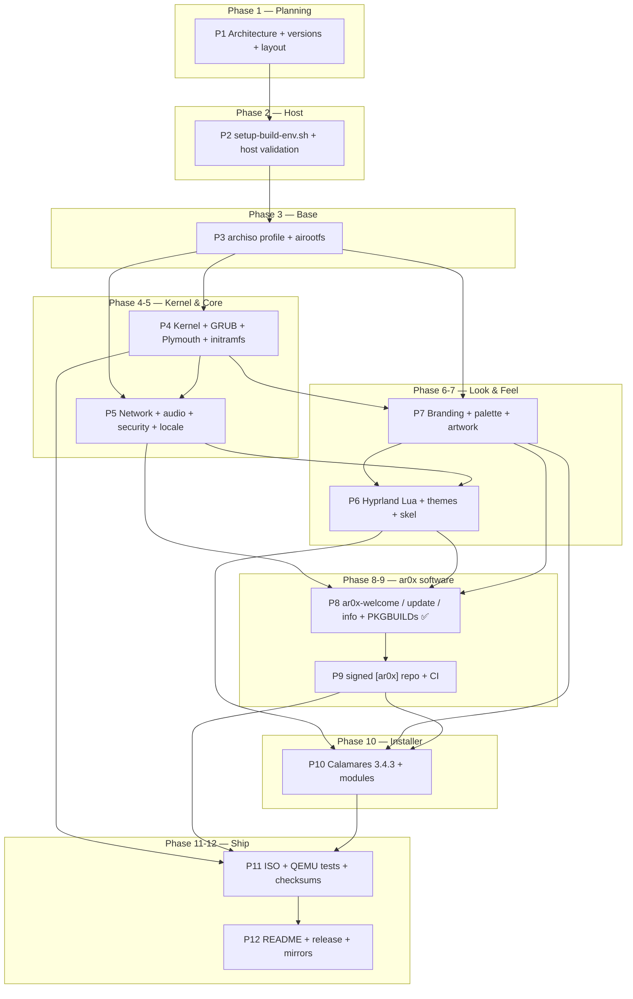

# ar0x — Build Order Dependency Graph

> Phase 1 companion to [`PROJECT_PLAN.md`](../../PROJECT_PLAN.md).
> A node is a **build artifact or a completed configuration set**. An edge `A → B` means
> **B cannot start until A's exit gate passes**. No cycles: this is a DAG.

---

## 1. Executive graph (phase level)



**Critical path:** `P1 → P2 → P3 → P4 → P7 → P6 → P8 → P9 → P10 → P11 → P12` (11 nodes).
`P5` is the only substantial parallel branch; it can be developed after `P3` while `P4` runs,
and its output is consumed by `P6` and `P8`.

---

## 2. Detailed artifact graph

Node IDs are used in §3 (topological order) and in `tools/build-iso.sh` stage names.

```mermaid
flowchart TD
    subgraph H["HOST"]
        H1["H1 version pins<br/>config/versions.env"]
        H2["H2 host packages + dirs<br/>setup-build-env.sh"]
        H3["H3 build root<br/>/opt/ar0x-build/*"]
    end
    subgraph B["BASE"]
        B1["B1 frozen pacman.conf.build"]
        B2["B2 packages.x86_64"]
        B3["B3 profiledef.sh"]
        B4["B4 airootfs base<br/>mkarchiso bootstrap"]
        B5["B5 packages.lock"]
    end
    subgraph K["KERNEL / BOOT"]
        K1["K1 linux-lts 6.18.59"]
        K2["K2 mkinitcpio.conf → initramfs"]
        K3["K3 GRUB UEFI+BIOS cfg"]
        K4["K4 Plymouth ar0x theme"]
        K5["K5 ISO boot catalogs<br/>isolinux/syslinux/efiboot"]
    end
    subgraph C["CORE SYSTEM"]
        C1["C1 NetworkManager"]
        C2["C2 PipeWire + WirePlumber"]
        C3["C3 locale/tz/keymap"]
        C4["C4 users + sudo + polkit"]
        C5["C5 journald + sysctl"]
        C6["C6 nftables + AppArmor"]
    end
    subgraph V["BRANDING (Phase 7 ✅)"]
        V1["V1 palette.conf + versions.env parity"]
        V2["V2 /etc identity + ASCII x3 + fetch configs"]
        V3["V3 SVG masters + icon + logo PNGs"]
        V4["V4 GRUB theme (final art + layout)"]
        V5["V5 Plymouth splash (final art)"]
        V6["V6 SDDM theme"]
        V7["V7 ar0x-cursors XCursor theme"]
        V8["V8 syslinux splash (final art)"]
    end
    subgraph D["DESKTOP"]
        D1["D1 Hyprland 0.57.1 + lua"]
        D2["D2 hyprlock/idle/paper/portal"]
        D3["D3 Waybar + launcher + notify"]
        D4["D4 GTK3/4 + Qt5/6 + icons/cursor/fonts"]
        D5["D5 wallpapers"]
        D6["D6 /etc/skel dotfiles (zsh)"]
    end
    subgraph T["TOOLS (Phase 9 ✅ — ALL 8 PKGBUILDs)"]
        T1["T1 ar0x-welcome GTK4 (lazy gi)"]
        T2["T2 ar0x-update (non-root, SigLevel)"]
        T3["T3 ar0x-info (fastfetch + Bash)"]
        T4["T4 3 .desktop + 2 units + 2 helpers"]
        T5["T5 8 PKGBUILDs + 57/57 SHA-256 (NOT built)"]
        T6["T6 ADR-024 private trees + 3 appliers"]
    end
    subgraph R["REPO (Phase 9 ✅ tooling / MANUAL signing)"]
        R1["R1 GPG key PENDING-KEYGEN (MANUAL)"]
        R2["R2 repo-add -s → ar0x.db (driver ready)"]
        R3["R3 3 CI workflows: PR-safe / build / release"]
        R4["R4 [ar0x] pacman.conf entry (Required)"]
    end
    subgraph I["INSTALLER"]
        I1["I1 Calamares 3.4.3 build"]
        I2["I2 settings.conf + modules"]
        I3["I3 ar0x branding module"]
        I4["I4 package-select groups"]
        I5["I5 bootloader module"]
    end
    subgraph S["SHIP"]
        S1["S1 build-iso.sh orchestrator"]
        S2["S2 mkarchiso → .iso"]
        S3["S3 QEMU UEFI + BIOS"]
        S4["S4 SHA256SUMS + .sig"]
        S5["S5 README + release notes"]
    end

    H1 --> H2 --> H3
    H1 --> B1
    H3 --> B4
    B1 --> B4
    B2 --> B4
    B3 --> B4
    B4 --> B5
    B4 --> K1
    K1 --> K2
    K1 --> K3
    V4 --> K3
    V5 --> K4
    K2 --> K4
    K3 --> K5
    K4 --> K5
    B4 --> C1
    B4 --> C2
    B4 --> C3
    B4 --> C4
    B4 --> C5
    C5 --> C6
    C4 --> C6
    B4 --> V1
    V1 --> V2
    V1 --> V3
    V1 --> V4
    V1 --> V5
    V1 --> V6
    K1 --> D1
    C1 --> D3
    C2 --> D3
    C4 --> D6
    V1 --> D4
    V3 --> D4
    V6 --> D3
    D1 --> D2
    D1 --> D6
    D2 --> D6
    D3 --> D6
    D4 --> D6
    D5 --> D6
    C3 --> D6
    V2 --> T3
    T1 --> T4
    T2 --> T4
    T3 --> T4
    T4 --> T5
    D6 --> T5
    V2 --> T5
    R1 --> R2
    T5 --> R2
    R2 --> R3
    R2 --> R4
    R4 --> I1
    V2 --> I3
    V3 --> I3
    I1 --> I2
    I3 --> I2
    R4 --> I4
    K3 --> I5
    I2 --> I5
    I4 --> I5
    B5 --> S1
    K5 --> S1
    C6 --> S1
    D6 --> S1
    V2 --> S1
    R2 --> S1
    I5 --> S1
    S1 --> S2
    S2 --> S3
    S2 --> S4
    S3 --> S5
    S4 --> S5
```



---

## 3. Edge list (machine-readable intent)

```
H1 → H2, B1              H2 → H3                 H3 → B4
B1 → B4                  B2 → B4                 B3 → B4                 B4 → B5,K1,C1,C2,C3,C4,C5,V1
K1 → K2,K3,D1            K2 → K4                 V4 → K3                 V5 → K4
K3 → K5                  K4 → K5                 C5 → C6                 C4 → C6
V1 → V2,V3,V4,V5,V6,D4  V3 → D4                 C1 → D3                 C2 → D3
C3 → D6                  C4 → D6                 V6 → D3                 D1 → D2,D6
D2 → D6                  D3 → D6                 D4 → D6                 D5 → D6
V2 → T3,T5               T1 → T4                 T2 → T4                 T3 → T4
T4 → T5                  D6 → T5                 R1 → R2                 T5 → R2
R2 → R3,R4               R4 → I1,I4              V2 → I3                 V3 → I3
I1 → I2                  I3 → I2                 K3 → I5                 I2 → I5
I4 → I5                  B5,K5,C6,D6,V2,R2,I5 → S1
S1 → S2                  S2 → S3,S4              S3 → S5                 S4 → S5
```

---

## 4. Topological build order (what `tools/build-iso.sh` executes in Phase 11)

| # | Node | Stage command / artifact | Blocked by |
|---:|---|---|---|
| 1 | H1 | `source config/versions.env`; `tools/validate-versions.sh` | — |
| 2 | H2 | `tools/setup-build-env.sh` (Phase 2, host-only) | 1 |
| 3 | H3 | create `/opt/ar0x-build/{work,out,cache,src,repo,keys,logs}` | 2 |
| 4 | B1 | `bootstrap.sh --sync`: render `config/pacman.conf.build` → `archiso/pacman.conf` (frozen `2026/11/01`, `[ar0x]` first) | 1, 3 |
| 5 | B2 | sync `config/packages.x86_64` + `config/bootstrap_packages.x86_64` → `archiso/` | 1 |
| 6 | B3 | canonical `archiso/profiledef.sh` (archiso 92: `buildmodes`, `bootmodes`, `file_permissions`) + `grub/grub.cfg`, `syslinux/syslinux.cfg`, `airootfs/etc/mkinitcpio.conf.d/archiso.conf` | 1 |
| 7 | B4 | `bootstrap.sh`: stage `archiso/` → `/opt/ar0x-build/profile/` (drop `[ar0x]` block if no db), then `mkarchiso -v -m "bootstrap iso" -w work -o out <stage>` → `work/x86_64/airootfs` | 3,4,5,6 |
| 8 | B5 | `pacman -Q --sysroot work/x86_64/airootfs > out/packages.lock` | 7 |
| 9 | K1 | install `linux-lts 6.18.59-1` + headers in airootfs | 7 |
| 10 | V1 | `config/versions.env` 8 hex pins + `config/branding/palette.conf` parity gate | 7 |
| 11 | V2/V3/V4/V5/V6/V7/V8 | `/etc` identity, 3 ASCII variants, 4 SVGs + 2 logo PNGs + `LOGO` icon, 5 XCursor shapes × 3 sizes + 12 aliases, final GRUB/Plymouth/syslinux art, `tools/lib/{ar0x_logo.py,ar0x_xcursor.py}`, `gen-branding-assets.sh`, `configure-branding.sh`, `docs/BRANDING_GUIDE.md` | 10 |
| 12 | C1–C6 | `configure-system.sh --sync`: 23 `config/system/**` files → `/etc/**`; `config/pacman.conf.installed` → `/etc/pacman.conf`; `--apply` runs `locale-gen` + `systemctl preset-all` in chroot | 7 |
| 13 | K2 | `build-kernel.sh --audit-config /boot/config-linux-lts` (stock kernel; NO compile) then `--sync` of `config/mkinitcpio.conf` + preset | 9, 1 |
| 14 | K4 | install Plymouth `ar0x` script theme + `plymouth` hook into the initramfs | 11, 13 |
| 15 | K3 | ar0x GRUB gfxmenu theme (fontless, `--themes=""`) + branded UEFI/BIOS configs | 9, 11 |
| 16 | K5 | isolinux/syslinux/efiboot ISO boot catalogs | 14, 15 |
| 17 | D1 | `gen-desktop-assets.sh`: 3× 4K wallpapers + SDDM bg (deterministic PNGs) | 10 |
| 18 | D2 | 37 Phase 6 packages appended to `config/packages.x86_64`; `enable sddm.service` added to `50-ar0x.preset` | 5, 12 |
| 19 | D3 | `hyprland.lua` + 10 `lua/*.lua` modules + `hyprpaper`/`hyprlock`/`hypridle` ⚠️ **Lua ONLY, zero `.conf`** | 9, 10, 18 |
| 20 | D4 | GTK3/GTK4, Qt5/Qt6 (`qt5ct:qt6ct`), fontconfig, icons, cursors, Waybar/kitty/wofi/mako | 10, 18 |
| 21 | D5 | SDDM Qt6 QML theme (`Main.qml`, `metadata.desktop`, `theme.conf`, bg.png) + `/etc/sddm.conf.d/10-ar0x.conf` | 10, 17, 18 |
| 21b | D6 | `configure-desktop.sh --sync`: render `config/desktop/<tool>/**` → `skel/.config/**`, mirror `skel/**` → `/etc/skel/**`, `etc/**` → `/etc/**`, art → `/usr/share/**`; `--apply` refreshes caches + `preset-all` + `Hyprland --verify-config` | 12, 17, 19, 20, 21 |
| 21c | V2/V3/V7 | `configure-branding.sh --sync`: mirror identity → `/etc/**` + `/usr/lib/os-release`, ASCII/SVG/icon → `/usr/share/**`, fetch configs → `/etc/skel/.config/**`; `--check` parses every SVG/PNG/XCursor back | 10, 11, 21b |
| 22 | T1–T4 | ✅ **Phase 8 COMPLETE**: `ar0x-welcome` (GTK4, lazy `gi`), `ar0x-update` (non-root, SigLevel-verified), `ar0x-info` (fastfetch + pure-Bash fallback), 3 `.desktop` files, 2 systemd units, 2 helpers, `ar0x-welcome.install`, `config/tools/**`, `tools/configure-tools.sh`, `tools/lib/ar0x_pkgbuild.py`, `docs/TOOLS_GUIDE.md` | 11, 21, 21c |
| 23 | T5/T6 | ✅ **Phase 9 COMPLETE (ADR-024)**: all 8 PKGBUILDs with 57/57 SHA-256 sums (56 real + 1 MANUAL `SKIP`), `0/8` overlay-owned paths, 31 byte-identical mirrors, `ar0x-keyring` trust bootstrap. ⚠️ NOT built/signed (`makepkg`/`gpg`/`repo-add` unavailable, RISK-048/049/051). Target: MANUAL `makepkg --nodeps` → `gpg --detach-sign` → `repo-add -s -v --include-sigs` → 8 signed tarballs | 21, 22, 24 |
| 24 | R1 | ⚠️ MANUAL GPG keys in `/opt/ar0x-build/keys/gnupg` (mode 0700); `RELEASE_KEY_FINGERPRINT = PENDING-KEYGEN`, `ar0x-trusted` EMPTY (RISK-051) | 3 |
| 25 | R2 | `tools/setup-repo.sh --sign` → `gpg --detach-sign` ×8 + `repo-add -s -v --include-sigs ar0x.db.tar.zst *.pkg.tar.zst` + `SHA256SUMS.sig`; `--verify` uses `ar0x_repo.repo_problems()` | 23, 24 |
| 26 | R3 | 3 workflows: `validate-packages.yml` (PR-safe, ZERO secrets), `build-packages.yml` (non-root `builder`, `makepkg --nodeps` ×8, unsigned local db), `release.yml` (NEVER `pull_request`, fork guard, signing) | 25 |
| 27 | R4 | `config/repo/{repo-options.conf,pacman.conf.ar0x-entry,RELEASE_KEY_FINGERPRINT}` + `[ar0x] SigLevel = Required` FIRST in `pacman.conf.installed` (ADR-017) | 25 |
| 28 | I1 | build Calamares 3.4.3 from the Codeberg tarball (verify SHA256 + `.asc`) | 27 |
| 29 | I2/I3 | `settings.conf`, module configs, ar0x branding module | 11, 28 |
| 30 | I4 | `minimal / standard / full` package-select groups | 27 |
| 31 | I5 | GRUB bootloader module (UEFI + BIOS + ESP) | 15, 29, 30 |
| 32 | S1 | `tools/build-iso.sh` assembles the full profile | 8,16,12,21,11,25,31 |
| 33 | S2 | `mkarchiso build` → `out/ar0x-0.1.0-x86_64.iso`; enforce ≤ 2.2 GB gate | 32 |
| 34 | S3 | `tools/qemu-test.sh` UEFI (`OVMF`) + BIOS (SeaBIOS) | 33 |
| 35 | S4 | `tools/checksum.sh` → `SHA256SUMS` + detached GPG sig | 33 |
| 36 | S5 | README / release notes / announcement drafts (Phase 12) | 34, 35 |

---

## 5. Critical path & parallelism

**Longest chain (wall-clock estimate on a 16-core / NVMe host):**
`H1 → H2 → H3 → B4 (pacstrap ~10 min) → B5 → S1 → S2 (squashfs zstd ~12 min) → S3 (~8 min) → S5`.

The **squashfs compression step (S2)** and the **pacstrap download (B4)** dominate. They are
accelerated by the shared `cache/pacman/pkg` and by keeping `work/` on NVMe.

**Parallelisable while B4 runs:** V1–V8 (pure text + pure-Python generators), T1–T3 (Python/shell source),
I2 module configs, and the PKGBUILD sources. These are all in the SOURCE ROOT and require no
root privileges — they are the work that can be done in this sandbox ahead of the host build.

**Hard serialisation points (require root / real hardware, §14 of PROJECT_PLAN.md):**
`H2`, `B4`, `K2` (initramfs generation), `S2`, `S3` (QEMU), `S4` (GPG signing).

---

## 6. Cycle checks & common ordering mistakes

| Mistake | Why it breaks | Guard |
|---|---|---|
| Plymouth theme after initramfs generation | The splash is embedded **inside** the initramfs; adding it later has no effect | Edge `V5 → K4 → K2` order enforced by stage 14 before 13's final rebuild; `build-iso.sh` re-runs `mkinitcpio` after installing the theme |
| GRUB theme before `palette.conf` exists | Colours drift between GRUB, Plymouth, SDDM | `V1` is the single source; all themes source `palette.conf` |
| `[ar0x]` repo after ISO build | Calamares `package-select` and `ar0x-meta` install from the repo during install | `R2 → S1` |
| `hyprland.conf` shipped | 0.57 ignores it → blank session | `validate-versions.sh` fails the build on any `.conf` in hypr config paths |
| Frozen `pacman.conf` shipped to installed system | Users stuck on 2026-11-01 packages | Two distinct files + `build-iso.sh` asserts the installed conf contains `[ar0x]` and NOT `archive.archlinux.org` |
| `[ar0x]` listed after `[core]`/`[extra]` in build `pacman.conf` | `[extra]`'s `hyprland 0.57.0-3` wins over the HARD-pinned `0.57.1` (ADR-017) | `AR0X_HARD_PIN_REPO_PRIORITY="first"` + `bootstrap.sh --check` compares repo line numbers; Phase 3 writes `[ar0x]` first with a `file://` server |
| `[ar0x]` db referenced before Phase 9 builds it | `pacman -Sy` aborts with "failed to synchronize all databases" | `bootstrap.sh` drops the marked repo block when no `ar0x.db` exists; Phase 11 re-adds it |
| `customize_airootfs.sh` used | deprecated in archiso 92, removed in a future release | `archiso/airootfs/etc/pacman.d/hooks/*.hook`; `--check` fails if the script appears |
| Kernel patch added in v0.1 | RISK-001: permanent fork, DKMS breakage, unbootable ISO | Zero patches; `build-kernel.sh --check` + `validate-versions.sh` fail on any `*.patch`/`*.diff` |
| `COMPRESSION="zstd"` without `CONFIG_RD_ZSTD` | kernel cannot unpack initramfs → black screen | Audit fragment asserts `CONFIG_RD_ZSTD=y`; FAILSAFE GRUB entry |
| Frozen build `pacman.conf` copied to `/etc` | installed system pinned to 2026-11-01 (RISK-006/032) | Two configs; `configure-system.sh --sync` writes only `pacman.conf.installed` to `/etc`; two validators |
| `sysctl --system` / `nft -f` inside a chroot | reconfigures the HOST kernel (RISK-034) | `--apply` uses only `-c`/`-cf` syntax checks |
| WirePlumber fragment in 0.4 `/etc/wireplumber/` | silently ignored on WP 0.5+ (RISK-037) | `/etc/pipewire/wireplumber.conf.d/`; legacy dir removed and asserted absent |
| A stray `hyprland.conf` | 0.57 ignores it → emergency binds / broken session (RISK-002) | Tree-wide `find` sweep in `validate-versions.sh` + `configure-desktop.sh --check` |
| Qt5-only QML imports in the SDDM theme | Qt6 greeter fails to load (RISK-038) | `QtVersion=6` metadata + import-line assertion; no `QtGraphicalEffects` |
| Global `GDK_BACKEND` | breaks XWayland GTK apps (RISK-039) | Comment-safe grep in two validators |
| Editing a GENERATED `skel/.config/**` copy directly | next `--sync` silently reverts it | `--check` asserts every generated copy is byte-identical to canonical |
| Two generators each carrying their own logo geometry | boot splash and standalone logo silently diverge | ONE `tools/lib/ar0x_logo.py` imported by both generators; `--check` parses the SVG and asserts equality |
| Editing `palette.conf` without `versions.env` (or vice versa) | GRUB/Plymouth/SDDM/Hyprland colours drift | 8/8 hex parity asserted by `configure-branding.sh --check` AND `validate-versions.sh` |
| Adding `neofetch` to `packages.x86_64` | AUR-only package breaks the reproducible ISO (RISK-010) | `configure-branding.sh --check` + `validate-versions.sh` both fail if it appears |
| A hand-written `Xcur` file with wrong TOC offsets | compositor silently falls back to Adwaita | `ar0x_xcursor.verify_xcursor()` parses magic/header/TOC/chunks/pixel count on every generated file |
| `set -euo pipefail` added to the screenFetch art snippet | strict mode leaks into screenFetch and aborts it | explicit exemption in `validate-versions.sh` + assertion in `configure-branding.sh --check` |
| `ar0x-screenfetch` wrapper not executable | `ar0x-screenfetch` fails at login | `--sync` chmod 0755; `--check` asserts `-x` on the profile copy |
| An `ar0x-*` package listed in `config/packages.x86_64` before Phase 9 | ISO build fails against the frozen snapshot; no signed repo exists (RISK-048) | `ar0x_pkgbuild.validate_no_repo_packages_yet()` fails the validator; only `python`, `python-gobject`, `fakeroot` are present |
| A PKGBUILD installing into `/etc/skel/**` or a Phase 6/7 `/usr/share/**` tree | duplicate ownership → `pacman: conflicting files` (ADR-024) | `ar0x_pkgbuild.validate_ownership()` asserts `OVERLAY_OWNED`; all 8 packages use `/usr/share/ar0x/<pkg>/**` + `/usr/bin/ar0x-apply-*` |
| Secrets on a `pull_request` workflow | private release key leaked to forked PR code (RISK-051) | `ar0x_repo.validate_workflows()` asserts ZERO secrets in the 2 PR workflows, NO `pull_request` trigger in `release.yml`, and an explicit fork guard |
| A stale `ar0x-public-key.asc` checksum after `--keygen` | `makepkg` checksum failure | `setup-repo.sh --sync` replaces the single `SKIP` with a real SHA-256; `ar0x_pkgbuild.py` allows `SKIP` ONLY for that one file |
| Editing `packages/ar0x-welcome/links.conf` instead of `config/tools/links.conf` | next `--sync` silently reverts it; `AR0X_URL_*` pins drift | `configure-tools.sh --check` asserts 5 byte-identical mirrors + URL parity |
| A stale `sha256sums` array after editing a tool | `makepkg` aborts with a checksum failure | `configure-tools.sh --sync` regenerates all 18 real SHA-256 sums; `--check` verifies each |
| Module-level `import gi` in `ar0x-welcome.py` | `--self-test` fails on headless CI with no GTK4 (RISK-047) | `ar0x_pkgbuild.validate_sources()` asserts `gi` is lazy; `run_gui()` imports it |
| Calamares built before Qt/KPMcore present | Link/compile failure | `R4 → I1` plus Phase 2 host package check |
| `gh release create` without `--verify-tag` | a tag is silently auto-created from the default branch (RISK-015) | `docs/RELEASE_GUIDE.md §4` + `prepare-release.sh --publish` print an annotated-tag-first, `--verify-tag` command; `ar0x_release.check_docs()` asserts it |
| A glob instead of the exact 6 assets | a detached `.sig` is silently omitted → unverifiable release | `ar0x_release.check_artifact_set()` asserts the exact set; negative-tested |
| DRAFT banners removed before a signed ISO exists | false release claim (RISK-054) | `check_docs()` + `validate-versions.sh §7m` assert `UNRELEASED` / `DO NOT PUBLISH` / `DO NOT SEND` |
| FPR published only in release notes | an attacker controlling the release can substitute the key too | ADR-028: FPR published OUT OF BAND in `README.md` |
| `--publish` actually uploading | irreversible publication of an unsigned artefact | driver is PRINT-ONLY, NEVER uploads; `--self-test` proves it refuses without `AR0X_CONFIRM_PUBLISH=yes` |
| `build-iso.sh --build` calling only `bootstrap.sh --sync` | `mkarchiso` receives a MISSING/STALE `$AR0X_PROFILE_STAGE` | ADR-029: new `bootstrap.sh --stage` really builds the disposable profile; `--build` calls `--stage --with-ar0x-repo --with-signed-packages` |
| Editing `config/packages.x86_64` to add `calamares` | breaks the RISK-048 offline gate and risks committing unsigned packages | ADR-029: staged-profile-only injection, enforced by `ar0x_build_release.py` + a REAL `--self-test` |
| Validators requiring literal `PENDING-KEYGEN` | the first real release gate (keygen) makes every validator FAIL | `validate-versions.sh §7m` accepts `PENDING-KEYGEN` OR a published 40-hex FPR with a signed db |
| ISO built before the signed `[ar0x]` db exists | `pacman` cannot resolve `ar0x-meta`/`calamares`; unusable ISO (RISK-048) | `build-iso.sh --build` dies on `PENDING-KEYGEN` + a missing `ar0x.db.tar.zst` (ADR-027) |
| `SHA256SUMS` committed to Git | stale sums after every rebuild; key material leak (RISK-051) | `.gitignore` + `ar0x_iso.check_checksum()` + `checksum.sh --check` assert derived artifacts stay in `out/` |
| QEMU UEFI launcher writes to the packaged `OVMF_VARS_4m.fd` | firmware vars corrupted for every later boot | launcher `mktemp` + `cp --` a DISPOSABLE writable copy; asserted by `ar0x_iso.check_qemu()` |
| Installer VM attached to a host device | ⚠️ RISK-004 irreversible data loss | disposable qcow2 only + `AR0X_CONFIRM_DISPOSABLE_VM=yes` + TYPED `AR0X_TARGET_DISK` |
| `md5`/`sha1` release checksums | collision attacks; §11 contract violated | `check_checksum()` rejects weak hashes; `build-options.conf` pins `sha256` |
| Test checklist shorter than 40 items | release gate silently weakened | `ar0x_iso.check_docs()` asserts exactly `T-01..T-40` unchecked; negative-tested |
| A flat Calamares module list (no `show`/`exec` phases) | 3.4.3 cannot enqueue view/job modules; install never starts | `settings.conf` 3 phases asserted by `ar0x_installer.py::check_settings()` (ADR-026) |
| `bootloader` before `unpackfs` | GRUB writes into a rootfs that does not exist yet | `EXEC_ORDER` asserts `unpackfs → … → grubcfg → bootloader` |
| `pacman -Sy` inside the offline installer | partial DB sync / partial upgrade, §9 contract violated | `packages.conf` `update_db/system: false`; `ar0x_installer.py` fails on `-Syu`/`--noconfirm`/`pacman -Sy` |
| A second `/etc/calamares` copy in `archiso/airootfs` | two owners; the overlay silently overwrites the live config | ADR-024; `configure-installer.sh --check` asserts the directory is ABSENT |
| `NOPASSWD` sudoers surviving the install | empty-password live account leaks into the target (RISK-013/033) | `removeuser` before `users`; `ar0x-installer-finish` ABORTS the install on any `NOPASSWD` rule (negative-tested) |
| `ar0x-firstboot.service` armed with `systemctl` in a chroot | D-Bus unavailable; unit never enabled | ADR-026 plain symlink + `uninitialized` `/etc/machine-id` sentinel |

---

## 7. Exit-gate DAG (phase-level confirmation)

```
GATE-1 (you confirm P1) ──> P2 ──> GATE-2 ──> P3 ──> GATE-3 ──> P4 ──> GATE-4
   ──> P5 ──> GATE-5 ──> P6 ──> GATE-6 ──> P7 ✅ ──> GATE-7 ──> P8 ✅ ──> GATE-8
   ──> P9 ✅ ──> GATE-9 ──> P10 ✅ ──> GATE-10 ──> P11 ✅ ──> GATE-11 ──> P12 ✅ ──> GATE-12 (MANUAL publication) ──> RELEASE
```

Every gate is an explicit user confirmation. No gate is auto-advanced.
